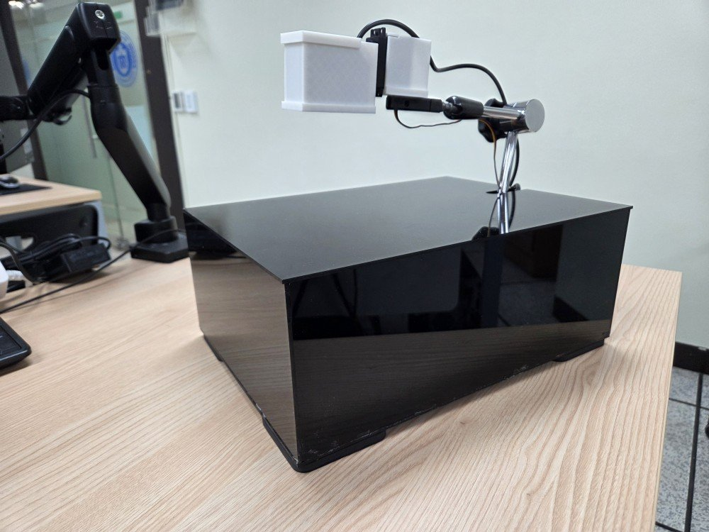
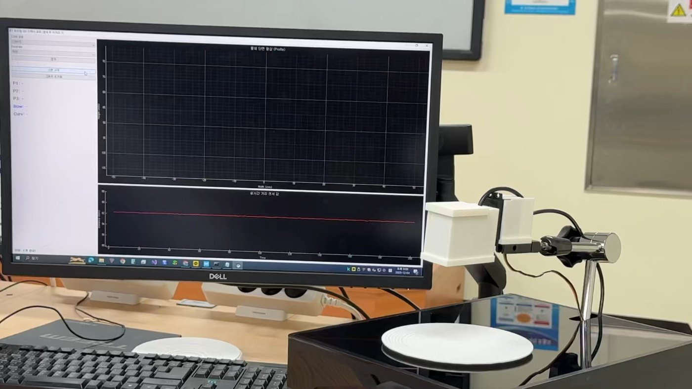
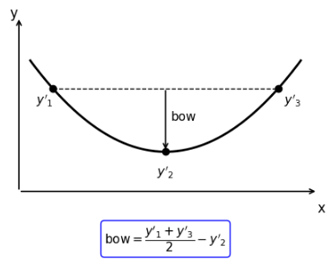
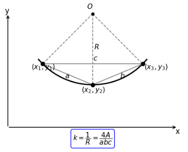
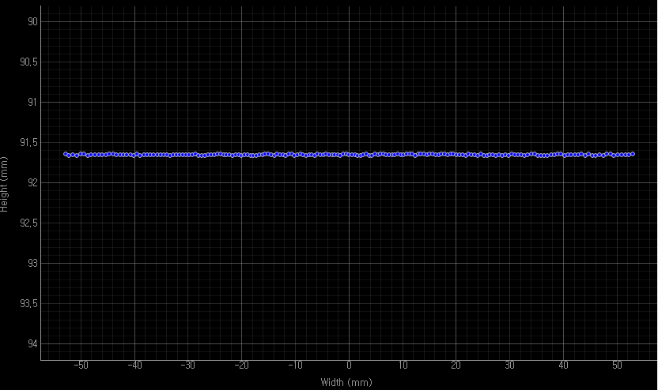
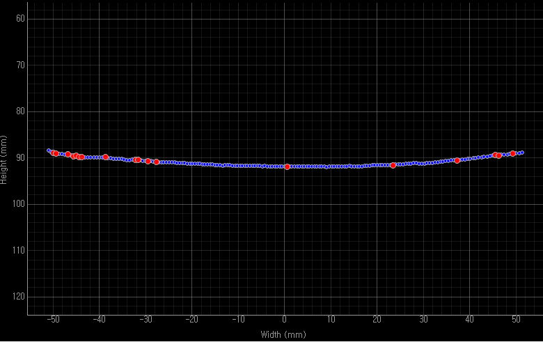
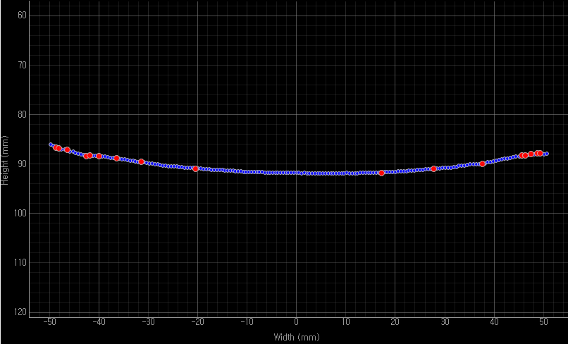
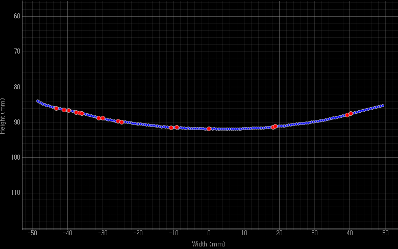

# 레이저 변위센서를 이용한 곡률 측정 시스템

> 2025 호서대학교 전자공학과 산학 프로젝트 (참여기업 ㈜천진)
> 🏆 **2025 반도체 역량강화 성과발표회 대상**

디스플레이·반도체 공정에서 문제가 되는 **기판의 휨(Bow)과 곡률**을, 레이저 변위센서 하나를 서보모터로 **원호 스캔**해 비접촉으로 측정하는 시스템입니다.
STM32가 센서 데이터를 받아 곡률과 평탄도를 계산하고, Python GUI가 단면 형상을 실시간으로 그려 불량(NG)을 자동 판정합니다.

<p align="center">
  
  
</p>

📑 [최종 발표자료 (pptx)](docs/presentation/최종발표자료_쏴조빔.pptx) · 🖼️ [포스터 (pptx)](docs/presentation/포스터_쏴조빔.pptx)

## 개발 배경

| 기존 방식의 한계 | 제안: 원호 스캔 시스템 |
|---|---|
| 접촉식 측정은 압력으로 표면에 스크래치·변형을 낼 수 있음 | 레이저 변위센서로 **비접촉** 측정 |
| 단일 지점 측정은 데이터 신뢰성이 낮고, 다점 측정 장비는 크고 비쌈 | **모터 1개**로 -30° ~ +30° 를 연속 스캔해 넓은 범위 측정 |
| 결과 확인까지 시간이 걸림 | 형상을 **실시간 그래프**로 보여줘 공정 피드백을 빠르게 |

## 시스템 구성

```
┌──────────── PC (Python GUI) ────────────┐        ┌─────────────── STM32F411CEU6 ───────────────┐
│ 포트 연결 · 스캔 시작('M')               │──UART──▶│ USART1 RX 인터럽트 → 스캔 상태머신           │
│ 단면 형상 그래프 / 실시간 거리 그래프     │◀─UART──│ TIM1 PWM (50Hz) → 서보모터 -30° ~ +30°     │
│ 이동평균 잔차 > 0.05mm → NG 판정·표시    │        │ ADC1 (8x 오버샘플링) ← 레이저 변위센서 BD-100 │
└─────────────────────────────────────────┘        │ Bow / 곡률 연산 → 결과 전송                  │
                                                    └─────────────────────────────────────────────┘
```

| 구분 | 내용 |
|---|---|
| MCU | STM32F411CEU6 (HSI 16MHz, STM32 HAL) |
| 센서 | 레이저 변위센서 BD-100 (삼각측량, 분해능 4μm, 측정거리 70~130mm, 응답 1ms) |
| 구동부 | 서보모터, 스캔 범위 ±30° |
| 기구 | 3D 프린팅 센서 마운트 + 마그네틱 스탠드 |
| PC | Python, PyQt5, pyqtgraph, pyserial |
| 통신 | UART 9600bps 8N1 |

### 핀 배치

| 핀 | 기능 | 연결 |
|---|---|---|
| PA0 | ADC1_IN0 | 레이저 변위센서 출력 (1~5V → 저항 분압 2.2kΩ/3.3kΩ) |
| PA8 | TIM1_CH1 (PWM 50Hz) | 서보모터 신호선 |
| PA9 / PA10 | USART1 TX / RX | USB-UART 변환기 → PC |

## 동작 흐름

1. **초기화** – PC에서 `스캔 시작`을 누르면 `'M'` 전송 → 서보가 원점(-30°)으로 이동해 2초간 안정화
2. **연속 스캔** – 서보를 3μs 펄스(약 0.27°)씩 회전하며 **30ms(약 33Hz)** 주기로 거리 측정 → `SCAN` 전송 (223 포인트)
3. **데이터 연산** – -30° / 0° / +30° 세 점으로 STM32에서 **평탄도(Bow)·곡률** 계산 → `RES` 전송
4. **결과 출력** – GUI가 단면 형상을 그리고, 이동평균 대비 **0.05mm 넘게 벗어난 점을 빨간 점**으로 표시해 OK/NG 판정

스캔하지 않을 때는 100ms마다 현재 거리를 보내 **실시간 거리 그래프**를 갱신합니다.

### MCU 상태머신 (블로킹 없이 `HAL_GetTick()` 기반)

```
        'M' 수신 (UART RX 인터럽트)
IDLE ───────────────────────────────▶ HOMING ──2s──▶ RUNNING ──+30° 도달──▶ CALC ──▶ IDLE
 │ 100ms마다 RTD 전송                  -30° 이동     30ms마다 측정·전송·한 스텝 이동   결과 전송·중앙 복귀
```

### UART 프로토콜 (ASCII, `\r\n` 종단)

| 방향 | 메시지 | 의미 |
|---|---|---|
| PC → MCU | `M` | 스캔 시작 |
| MCU → PC | `RTD,<거리 μm>` | 대기 중 실시간 거리 (100ms) |
| MCU → PC | `SCAN,<서보 펄스 μs>,<거리 μm>` | 스캔 데이터 (30ms) |
| MCU → PC | `RES,<P1>,<P2>,<P3>,<Bow μm>,<곡률×10⁶ (1/mm)>` | 연산 결과 |

MCU에서 `printf`의 float 출력(`-u _printf_float`)을 쓰지 않도록 **모든 값을 μm 단위 정수로 바꿔서 전송**합니다.

## 측정 알고리즘

| 평탄도 (Bow) | 곡률 (Curvature) |
|---|---|
|  |  |
| 좌·우 거리를 cos30°로 수직 깊이로 바꾼 뒤 평균에서 중앙 깊이를 뺌 | 세 점으로 만든 삼각형의 외접원 반지름 R, 곡률 k = 1/R = 4A / abc |

```c
/* (각도, 거리) → (x, y) 좌표 */
float x1 = -distance_storage[0] * sin30,  y1 = distance_storage[0] * cos30;
float x2 = 0.0f,                          y2 = distance_storage[1];
float x3 =  distance_storage[2] * sin30,  y3 = distance_storage[2] * cos30;

bow_value_mm  = (y1 + y3) / 2.0f - y2 - BOW_OFFSET;      /* 영점 보정 */
curvature_val = (4.0f * area) / (a * b * c);              /* k = 1/R  */
```

### ADC 분해능 개선

STM32 ADC 입력(0~3.3V)에 맞추려고 센서 출력(1~5V)을 분압하면서 분해능이 **13.43μm**까지 떨어지는 문제가 있었습니다.
샘플마다 **8회 오버샘플링 평균**을 적용해 **4.75μm**로 개선했습니다.

```c
for (int i = 0; i < OVERSAMPLE_COUNT; i++) {        /* OVERSAMPLE_COUNT = 8 */
    HAL_ADC_Start(&hadc1);
    if (HAL_ADC_PollForConversion(&hadc1, 10) == HAL_OK)
        adc_sum += HAL_ADC_GetValue(&hadc1);
    HAL_ADC_Stop(&hadc1);
}
```

## 결과

| CASE 1. 평평함 (FLAT) | CASE 2. 조금 휨 (LOW) |
|---|---|
|  |  |
| R = 5910.6 mm, Bow = -0.019 mm | R = 661.8 mm, Bow = -1.434 mm |

| CASE 3. 중간 휨 (MID) | CASE 4. 많이 휨 (HIGH) |
|---|---|
|  |  |
| R = 337.8 mm, Bow = -3.237 mm | R = 202.6 mm, Bow = -5.534 mm |

| 항목 | 설계 목표 | 최종 결과 |
|---|---|---|
| 측정 오차율 | ±1.0% 이내 | **±0.03%** |
| 반복 정밀도 | 0.1mm 이내 | **0.03mm** |
| 환경 안정성 | – | 금속·플라스틱·고무, 조도·바람·소음 조건에서 변동 **0.004mm 이하** |

3D 프린팅 시편 표면의 **미세한 적층 결**까지 잡아낼 정도의 정밀도를 확인했습니다.

## 폴더 구조

```
laser-curvature-scanner/
├── firmware/                     STM32CubeIDE 프로젝트 (STM32F411CEU6)
│   ├── bd-stm.ioc                CubeMX 설정 (ADC1, TIM1 PWM, USART1 + RX 인터럽트)
│   ├── Core/Src/main.c           스캔 상태머신, 거리 측정, Bow/곡률 연산, UART 프로토콜
│   ├── Core/Src/stm32f4xx_it.c   USART1 인터럽트 핸들러
│   └── Drivers/                  STM32 HAL / CMSIS
├── gui/
│   ├── main.py                   PyQt5 + pyqtgraph GUI
│   └── requirements.txt
└── docs/
    ├── images/                   README 사진
    └── presentation/             최종 발표자료, 포스터
```

## 실행 방법

**펌웨어**
1. STM32CubeIDE에서 `File → Import → Existing Projects into Workspace` 로 `firmware/` 를 엽니다.
2. 빌드 후 ST-LINK로 STM32F411CEU6에 다운로드합니다.

**GUI**
```bash
cd gui
pip install -r requirements.txt
python main.py
```
COM 포트와 9600bps를 고른 뒤 `연결` → `스캔 시작` 을 누릅니다.

## 팀 / 역할

- 6인 팀 (하드웨어 3, 소프트웨어 3) · 지도교수 송동섭 교수님
- **이규현 – 하드웨어**: 레이저 변위센서·모터 선정, STM32 기반 제어 회로 구성

## 배운 점

- 계획과 달리 실제 구현에서는 **모터의 미세 진동, 센서 노이즈** 같은 물리적 변수가 컸고, 회로 수정과 코드 최적화를 반복하며 해결했습니다.
- 부품을 조립하는 데서 끝나지 않고, **하나의 측정 시스템을 설계하고 정밀도를 검증하는 전체 과정**을 경험했습니다.
